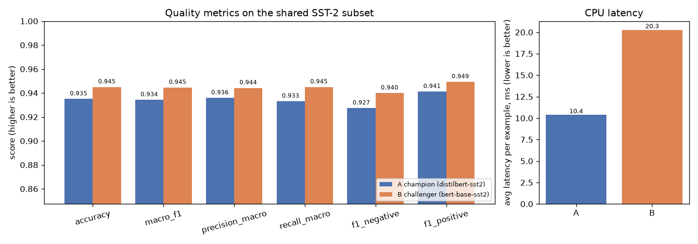
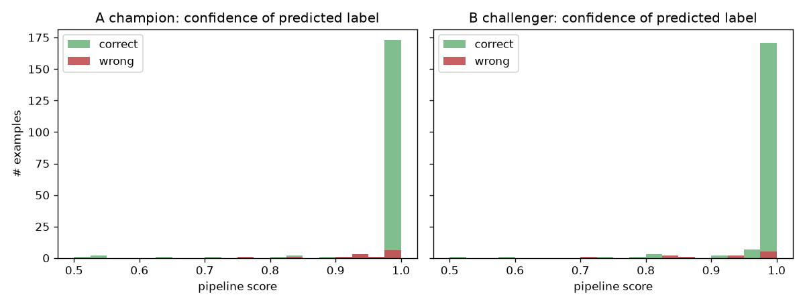
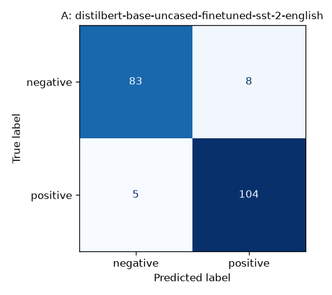
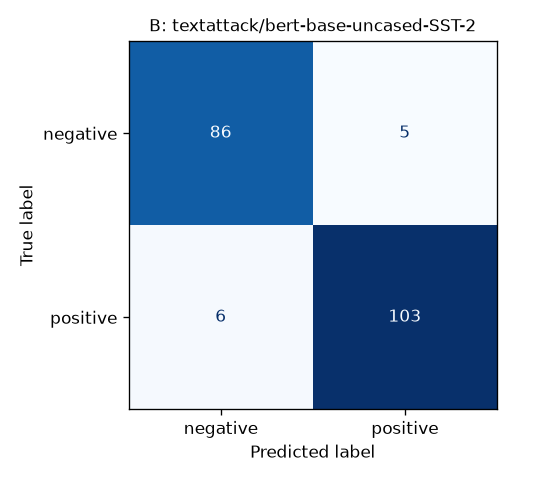
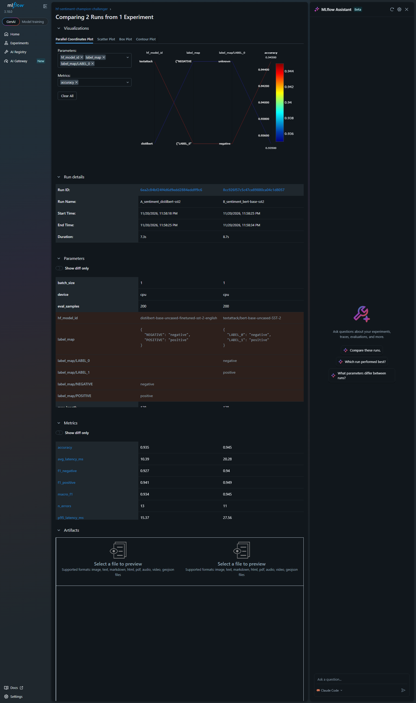
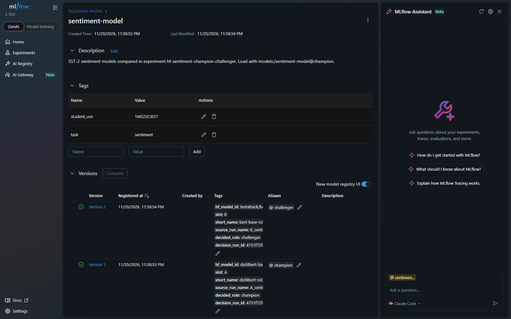
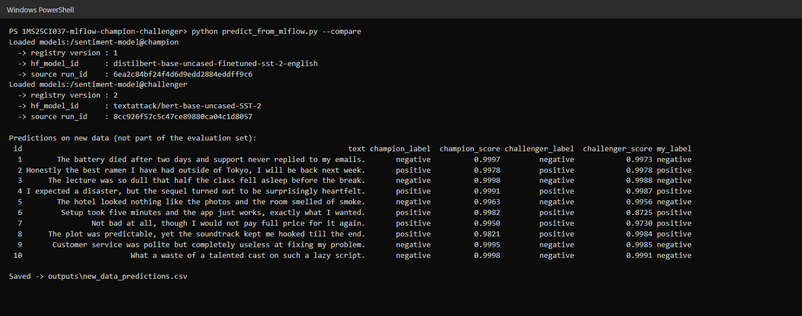

# Champion–Challenger Model Comparison with Hugging Face and MLflow

**Student USN:** 1MS25CI037 · Skill Lab (MLOps with MLflow) mini project · extends Labs 4, 5, 8, 9, 10, 11 and 13

Two pretrained Hugging Face sentiment models are run on the **same** SST-2 subset, everything is tracked in MLflow, a Champion is chosen with a rule that was written **before** the final run, both models are registered under one registered model with `champion` / `challenger` aliases, and the Champion is loaded back **by alias** to predict on brand-new sentences.

## 1. Task and models

| | |
|---|---|
| Task | Binary sentiment classification (negative / positive) |
| Dataset | GLUE **SST-2**, `validation` split (`nyu-mll/glue`, config `sst2`). Test labels are hidden, and both models were fine-tuned on the train split, so validation is the held-out set. |
| Subset size | **200** sentences, `DataFrame.sample(n=200, random_state=42)`, saved once in [`data/eval_inputs.csv`](data/eval_inputs.csv) (columns `row_id, sst2_idx, text, reference`) and reused in the same order for both models |
| Model A (current Champion) | [`distilbert-base-uncased-finetuned-sst-2-english`](https://huggingface.co/distilbert-base-uncased-finetuned-sst-2-english) · ~67M params · outputs `NEGATIVE/POSITIVE` |
| Model B (Challenger) | [`textattack/bert-base-uncased-SST-2`](https://huggingface.co/textattack/bert-base-uncased-SST-2) · ~110M params · outputs `LABEL_0/LABEL_1`, mapped to `negative/positive` (SST-2 convention 0 = negative, 1 = positive; check: the mapped model scores 94.5 %, an inverted map would score ~5 %) |
| Inference settings | `pipeline("text-classification")`, CPU, `truncation=True`, `max_length=128`, one sentence per call (`batch_size=1`) so per-example latency is meaningful, one untimed warm-up call, seed 42 |
| MLflow experiment | `hf-sentiment-champion-challenger` · registered model `sentiment-model` |

### Repository layout

```
├── README.md
├── requirements.txt
├── evaluate.py              # runs A and B on the same inputs, logs runs/metrics/artifacts/models, applies the rule
├── register_champion.py     # registers both models, sets @champion / @challenger aliases (+ --swap-aliases)
├── predict_from_mlflow.py   # loads models:/sentiment-model@champion and predicts on new data (no HF code)
├── src/
│   ├── config.py            # all settings + the Champion rule constants
│   └── sentiment_pyfunc.py  # custom mlflow.pyfunc.PythonModel wrapping the HF pipeline (Lab 9)
├── data/
│   ├── eval_inputs.csv      # shared evaluation set (200 rows, with references)
│   └── new_data.csv         # 10 new hand-written sentences, NOT from SST-2
├── outputs/                 # predictions, metrics, plots, disagreements, new-data predictions
└── screenshots/             # MLflow compare view, registry aliases, predict_from_mlflow.py output
```

## 2. How to run

Tested on Windows 11, Python 3.14, CPU only. Commands are run from the repository root.

```bash
# 0) install
pip install -r requirements.txt

# 1) start the MLflow tracking server (separate terminal, leave it running)
python -m mlflow server --host 127.0.0.1 --port 5000 --backend-store-uri sqlite:///mlflow.db --artifacts-destination ./mlartifacts

# 2) (optional) quick debug run on 10 rows -> goes to experiment "...-debug"
python evaluate.py --limit 10

# 3) full evaluation of both models on the 200 shared rows (~2 min after model download)
python evaluate.py

# 4) register both models and set the aliases from the logged decision
python register_champion.py

# 5) load the Champion by alias and predict on the new data
python predict_from_mlflow.py              # champion only
python predict_from_mlflow.py --compare    # champion and challenger side by side (used for outputs/new_data_predictions.csv)

# 6) stretch goal: flip the aliases, rerun the SAME script, then restore
python register_champion.py --swap-aliases
python predict_from_mlflow.py --out outputs/new_data_predictions_after_flip.csv
python register_champion.py
```

The tracking URI defaults to `http://127.0.0.1:5000` and can be overridden with the `MLFLOW_TRACKING_URI` environment variable. No run IDs are hard-coded anywhere: `register_champion.py` finds the latest finished `compare_sentiment` run and reads the child run IDs and the winner from its tags.

## 3. Champion rule (written before the final run)

This rule was committed to this README and to `src/config.py` in the first commit (`Project scaffold ... Champion rule (written before any run)`), **before** `evaluate.py` was run on the full set, and it has not been changed since. See `git log`.

1. **Primary metric:** macro-F1 on the 200-sentence evaluation set. **Higher is better.**
2. **Minimum improvement margin:** the Challenger must beat the Champion by **at least 2 percentage points of macro-F1** (`delta = F1_B − F1_A ≥ 0.02`). Otherwise the Champion stays.
   *Why 2 points:* with 200 examples one sentence is worth 0.5 points, and the standard error of an accuracy near 90 % is about √(0.9·0.1/200) ≈ 2.1 points. A smaller margin would let noise decide the winner, and swapping a deployed model has a real cost (a bigger model, re-validation), so the Challenger has to show a gain about the size of one standard error.
3. **Guardrail:** the Challenger is rejected regardless of accuracy if its average latency per example is **more than 3× the Champion's**.
4. **Tie-breaker:** if `|delta| < 0.02` (within the margin), the **faster** model (lower `avg_latency_ms`) is the Champion. If the Challenger is worse by more than the margin, the Champion stays.

Metric directions:

| Metric | Direction |
|---|---|
| accuracy, macro_f1, precision_macro, recall_macro, f1_negative, f1_positive | higher is better |
| n_errors, avg_latency_ms, p95_latency_ms, total_inference_s | lower is better |
| delta_primary_metric (B − A) | positive means the Challenger is better |

## 4. Results

200 SST-2 validation sentences, identical for both models (full numbers in [`outputs/comparison_table.csv`](outputs/comparison_table.csv) and [`outputs/metrics_summary.json`](outputs/metrics_summary.json)).

| Metric | Direction | A · distilbert-sst2 (Champion) | B · bert-base-sst2 (Challenger) | Δ (B − A) |
|---|---|---:|---:|---:|
| **macro_f1 (primary)** | ↑ | **0.9343** | **0.9446** | **+0.0103** |
| accuracy | ↑ | 0.9350 | 0.9450 | +0.0100 |
| precision_macro | ↑ | 0.9359 | 0.9442 | +0.0084 |
| recall_macro | ↑ | 0.9331 | 0.9450 | +0.0119 |
| f1_negative | ↑ | 0.9274 | 0.9399 | +0.0125 |
| f1_positive | ↑ | 0.9412 | 0.9493 | +0.0081 |
| n_errors (of 200) | ↓ | 13 | 11 | −2 |
| avg_latency_ms | ↓ | 10.39 | 20.28 | +9.89 (1.95×) |
| p95_latency_ms | ↓ | 15.37 | 27.56 | +12.19 |
| total_inference_s | ↓ | 2.08 | 4.06 | +1.98 |
| parameters | ↓ | ~67M | ~110M | |

Paired check (informational, not part of the rule): the models disagree on only **8** sentences; A alone is right on 3, B alone on 5. Exact McNemar test **p = 0.73**.

| Comparison of all metrics | Confidence of correct vs wrong predictions |
|---|---|
|  |  |

| Confusion matrix A | Confusion matrix B |
|---|---|
|  |  |

### Where the models disagree (all 8 cases, commented)

Also in [`outputs/disagreements_commented.csv`](outputs/disagreements_commented.csv).

| row | sentence (shortened) | truth | A | B | comment |
|---|---|---|---|---|---|
| 4 | "it moves quickly, adroitly, and without fuss; it doesn't give you time to reflect on the inanity …" | pos | **pos** | neg | Mixed review; B over-weights the negative clause ("inanity"). |
| 44 | "it has all the excitement of eating oatmeal." | neg | **neg** | pos | Sarcasm. A is right but only 0.54 confident; B is fooled by "excitement". |
| 56 | "oh come on." | neg | pos | **neg** | No sentiment word at all; A is wrong with 0.99 confidence (overconfident). |
| 94 | "a bloated gasbag thesis grotesquely impressed by its own … self-importance" | neg | pos | **neg** | Strong negative vocabulary; A is maybe misled by "impressed". |
| 112 | "… a manual of precinct cliches, but it moves fast enough to cover its clunky dialogue …" | pos | neg | **pos** | The "but" clause carries the verdict; B follows it. |
| 116 | "sustains its dreamlike glide through … cheesy coincidences and voluptuous cheap effects …" | neg | pos | **neg** | Ironic praise; A reacts to "dreamlike glide". |
| 161 | "outer-space buffs might love this film, but others will find its pleasures intermittent." | neg | pos | **neg** | Hedged contrast; B handles it. |
| 183 | "not since tom cruise in risky business has an actor made such a strong impression in his underwear." | pos | **pos** | neg | Joke-framed compliment; B misreads it. |

## 5. Decision

**Champion: Model A, `distilbert-base-uncased-finetuned-sst-2-english` (registry version 1, alias `@champion`). Challenger: Model B, `textattack/bert-base-uncased-SST-2` (version 2, alias `@challenger`).**

The Challenger is slightly better on every quality metric: macro-F1 0.9446 vs 0.9343, so **delta = +1.03 percentage points**, which is 2 fewer errors out of 200. That is below the 2-point margin fixed in advance, so by the rule this is a tie and the tie-breaker applies: the faster model wins. DistilBERT needs 10.4 ms per sentence against 20.3 ms for BERT-base (1.95×, inside the 3× guardrail), so **the Champion stays**.

The difference is not meaningful at this sample size. The two models agree on 192 of 200 sentences; of the 8 disagreements B wins 5 and A wins 3, and an exact McNemar test gives p ≈ 0.73. One standard error of accuracy at this level is about 1.7 points, larger than the observed gap. A different random 200-sentence sample could easily reverse the order.

Trade-offs: B is about 65 % larger (110M vs 67M parameters) and twice as slow on CPU, which doubles serving cost for a gain that cannot be told apart from noise. Qualitatively, B handles "but"-contrasts and ironic praise a little better (rows 112, 116, 161), while A is better on some sarcasm and jokes (rows 44, 183). Both models make confident mistakes: A predicted "oh come on." as positive with 0.99 confidence. If a larger evaluation set (for example all 872 validation sentences) confirmed a gain of 2 points or more, B would be worth reconsidering.

The decision is logged in the `compare_sentiment` summary run as params `primary_metric=macro_f1`, `margin=0.02`, tag `winner=A:distilbert-base-uncased-finetuned-sst-2-english`, tag `decision_reason`, and metrics `delta_primary_metric=0.0103`, `latency_ratio_B_over_A=1.95`, `mcnemar_p_value=0.727`.

## 6. MLflow organisation

| Run | Contents |
|---|---|
| `compare_sentiment` (parent / summary) | params `primary_metric`, `margin`, `latency_guardrail_x`, `tie_breaker`, both HF IDs; tags `winner`, `winner_slot`, `decision_reason`, `run_id_A`, `run_id_B`, `student_usn`, `library_versions`, `dataset_name`; metrics `delta_primary_metric`, `delta_accuracy`, `latency_ratio_B_over_A`, `mcnemar_p_value`, A/B macro-F1 and latency; artifacts: comparison bar chart, confidence histogram, `comparison_table.csv`, `metrics_summary.json`, `disagreements_all.csv`, `disagreements_commented.csv`, `data/eval_inputs.csv`, `README.md`, `requirements.txt` |
| `A_sentiment_distilbert-sst2` (nested) | params `hf_model_id`, `task`, `role`, `max_length`, `batch_size`, `truncation`, `eval_samples`, `seed`, `device`, `label_map`, `params_millions`; tags `student_usn`, `library_versions`, `dataset_name`, `role`; all metrics in the table above; artifacts `predictions_distilbert-sst2.csv`, `metrics_summary.json`, `data/eval_inputs.csv`, `plots/confusion_matrix_*.png`, `tables/predictions_*.json`; the **pyfunc model** `model` |
| `B_sentiment_bert-base-sst2` (nested) | same as A |

**Model logging.** Each model is logged with `mlflow.pyfunc.log_model(name="model", python_model=HFSentimentModel(), artifacts={"hf_model_dir": ...}, model_config={hf_model_id, label_map, max_length}, code_paths=["src/sentiment_pyfunc.py"], signature=..., input_example=...)`. The Hugging Face weights and tokenizer are saved inside the MLflow model, so `runs:/<id>/model` and `models:/sentiment-model@champion` load on their own. `predict()` takes a DataFrame with a `text` column and returns a DataFrame with `text, label, score`, with labels already mapped to `negative/positive`, so both versions give the same output format.

**Registry.** `register_champion.py` registers both runs' models under `sentiment-model` (version tags `hf_model_id`, `slot`, `decided_role`, `decision_run_id`) and sets `@champion` → v1 (A) and `@challenger` → v2 (B).

## 7. Prediction on new data (Step 5.6)

`predict_from_mlflow.py` imports only `mlflow` and `pandas`. It loads `models:/sentiment-model@champion` (and `@challenger` with `--compare`), and prints the registry version, HF model ID and source run, all read from the registry. Then it predicts on the 10 hand-written sentences in `data/new_data.csv`. None of them are in SST-2: they are product, restaurant and lecture reviews, and some are deliberately mixed ("Not bad at all, though…"). Output: [`outputs/new_data_predictions.csv`](outputs/new_data_predictions.csv). Both models get all 10 right (my own label is in `my_label`); the Challenger is noticeably less confident on sentence 6 (0.87).

**Stretch goal: alias flip.** [`outputs/alias_flip_demo.txt`](outputs/alias_flip_demo.txt) shows the unchanged script loading v1/DistilBERT, then `register_champion.py --swap-aliases`, then the same command loading v2/`textattack/bert-base-uncased-SST-2` with different scores ([`outputs/new_data_predictions_after_flip.csv`](outputs/new_data_predictions_after_flip.csv)), and finally the aliases being restored from the logged decision.

## 8. Screenshots

| MLflow compare view | Registry aliases | `predict_from_mlflow.py` output |
|---|---|---|
|  |  |  |

## 9. Limitations and declaration

- **Sample size.** 200 sentences are enough to debug and give a rough ranking, but not to separate two models that are about 1 point apart (McNemar p = 0.73). The decision rests on the pre-registered margin plus tie-breaker, not on a significant difference.
- **Same training data.** Both checkpoints were fine-tuned on SST-2 train, and SST-2 validation is from the same distribution, so both scores are optimistic for other domains (tweets, product reviews). The new-data check covers only 10 sentences.
- **Latency** was measured on one laptop CPU, one sentence at a time, after one warm-up call. Absolute numbers depend on the machine and on background load; the ~2× ratio is the more stable result.
- **Label mapping** for `textattack/bert-base-uncased-SST-2` (`LABEL_0`→negative, `LABEL_1`→positive) comes from the SST-2 convention, not from the model's config. The 94.5 % accuracy confirms it.
- **Environment note.** `datasets` could not be imported on the test machine (Windows Application Control blocked its compiled `xxhash` dependency), so the SST-2 validation parquet is downloaded directly with `huggingface_hub.hf_hub_download`. The data is the same as `load_dataset("glue", "sst2")`.
- **AI assistance declaration.** This project was built with the help of an AI coding assistant (Claude Code, Anthropic), which helped write the code, run the experiment and draft this README. I have reviewed the code and results and can explain every part in the viva.
